<div align="center">



<br />

**The official website of the BMSCE IEEE Computer Society Student Branch Chapter.**<br />
BMS College of Engineering, Bengaluru · Established 2021 · 2100+ members · 75+ events · 6 awards

<br />

[](https://www.bmsceieeecs.in)
[](https://nextjs.org)
[](https://react.dev)
[](https://r3f.docs.pmnd.rs)
[](https://tailwindcss.com)
[](https://www.apollographql.com)

[**Visit the website**](https://www.bmsceieeecs.in) · [What's inside](#whats-inside) · [Run locally](#getting-started) · [Update content](#updating-content) · [Deployment](#deployment)

</div>

---

## About the chapter

Established in 2021, BMSCE IEEE Computer Society is a hub for tech enthusiasts at BMS College of Engineering. Its mission is to build the technical skills of its members and prepare them to lead in computing, through national-level hackathons, hands-on workshops, talks and outreach.

This repository is the chapter's website: who we are, the team across the years, our initiatives and achievements, and every event we run.

## What's inside

| Page | What it shows |
| --- | --- |
| [`/`](https://www.bmsceieeecs.in) | Home: chapter intro and stats, vision and mission, team, gallery, initiatives, achievements and a contact form |
| [`/events`](https://www.bmsceieeecs.in/events) | Every event, grouped into upcoming and by year (2021 onwards) |
| `/events/<id>` | A single event with its poster, details and registration link |
| [`/wings`](https://www.bmsceieeecs.in/wings) | WINGS initiative |
| [`/ieeecsps`](https://www.bmsceieeecs.in/ieeecsps) | CS Project Series |
| [`/csreach`](https://www.bmsceieeecs.in/csreach) | CS Reach: outreach introducing school students to computer science |
| [`/cybermonth`](https://www.bmsceieeecs.in/cybermonth) | **Cyber Month 2026** event site (hosted separately, see [Hosted event sites](#hosted-event-sites)) |
| [`/bits`](https://www.bmsceieeecs.in/bits) | **CS BITS 2026** site (hosted separately) |

## Highlights

- **3D light-beam background:** the homepage sits on a real-time WebGL scene (React Three Fiber) of warm amber light beams drawn with a custom shader.
- **Motion throughout:** a logo loader, count-up stats, scroll-triggered reveals (Framer Motion), an animated grid behind the events pages and an auto-scrolling photo gallery.
- **Live events:** events load from the chapter portal's GraphQL API through Apollo Client, so publishing an event there updates the website.
- **Contact form:** messages sent from the site land straight in the chapter inbox.
- **One domain for every event:** event sites such as Cyber Month and CS BITS appear at `www.bmsceieeecs.in/<path>` while being built and deployed from their own repositories.

## Tech stack

| Area | Tools |
| --- | --- |
| Framework | [Next.js 15](https://nextjs.org) (App Router), [React 19](https://react.dev), TypeScript |
| Styling | [Tailwind CSS 4](https://tailwindcss.com), Space Grotesk and Montserrat via `next/font` |
| 3D and motion | [Three.js](https://threejs.org), [React Three Fiber](https://r3f.docs.pmnd.rs) and [drei](https://github.com/pmndrs/drei), [Framer Motion](https://motion.dev) |
| Data | [Apollo Client](https://www.apollographql.com/docs/react) (GraphQL, chapter portal API) |
| Email | [Nodemailer](https://nodemailer.com) (contact form) |
| Hosting | [Vercel](https://vercel.com), custom domain www.bmsceieeecs.in |

## Getting started

**Requirements:** Node.js 20 or newer, and npm.

```bash
git clone https://github.com/BMSCE-IEEE-CS/bmsceieeecs.git
cd bmsceieeecs
npm ci
```

Create a `.env.local` file in the project root (Git ignores it):

```bash
# Chapter portal GraphQL API (events)
NEXT_PUBLIC_PORTAL_URI=      # production endpoint
NEXT_PUBLIC_PORTAL_DEV=      # endpoint used by `npm run dev`

# Contact form (Gmail account and app password)
EMAIL_ID=
EMAIL_PASS=
```

Then start the development server:

```bash
npm run dev
```

Open **http://localhost:3000**.

| Command | What it does |
| --- | --- |
| `npm run dev` | Development server with Turbopack and hot reload |
| `npm run build` | Production build |
| `npm run start` | Serve the production build |

### Environment variables

| Variable | Used by | Description |
| --- | --- | --- |
| `NEXT_PUBLIC_PORTAL_URI` | Events | GraphQL endpoint of the chapter portal (production) |
| `NEXT_PUBLIC_PORTAL_DEV` | Events | GraphQL endpoint used in development |
| `EMAIL_ID` | Contact form | Gmail address that sends and receives contact messages |
| `EMAIL_PASS` | Contact form | Gmail app password for that account |

Ask a chapter maintainer for the values, and never commit them.

## Project structure

```text
├── app/
│   ├── page.tsx                 Homepage: loader, then every section over the 3D background
│   ├── layout.tsx               Root layout and fonts
│   ├── (events)/events/         /events and /events/[id]
│   ├── (wings)/  (ieeecsps)/  (csreach)/    Initiative pages
│   └── api/contact/             Contact form, sends the email
├── components/
│   ├── Home/                    Navbar, Hero, About, Team, Gallery, Initiatives, Achievements, Contact, Footer
│   ├── Events/                  Event cards
│   ├── Wings/  CSPS/            Initiative page headers
│   └── bg/                      Beam (3D light beams) and Squares (animated grid)
├── lib/
│   ├── client.ts                Apollo Client for the portal API
│   └── operations.ts            GraphQL queries for events
├── public/images/               Logos, team photos, gallery, awards, initiative images
└── next.config.ts               Routes for the hosted event sites (/cybermonth, /bits)
```

## Updating content

| To update | Where |
| --- | --- |
| Events | Publish them on the chapter portal; the site reads them through GraphQL |
| Team members (per year) | `teamData` in `components/Home/Team.tsx`, photos in `public/images/people/<year>/` |
| Gallery photos | `public/images/carousel/`, listed in `components/Carousel.tsx` |
| Achievements | `components/Home/Achievements.tsx`, images in `public/images/awards/` |
| Initiatives | `components/Home/Initiatives.tsx` and the initiative pages in `app/` |
| Chapter intro | `components/Home/Hero.tsx` |
| Stats (members, events, awards) | `statData` in `components/Home/Stat.tsx` |

## Hosted event sites

Event sites are built in their own repositories and Vercel projects, then shown on this domain through rewrites in [`next.config.ts`](next.config.ts):

| Path | Site | Served from |
| --- | --- | --- |
| `/cybermonth` | Cyber Month 2026 | `ieeecs-cybermonth.vercel.app` |
| `/bits` | CS BITS 2026 | `cs-bits-2026.vercel.app` |

To add another, the event site must serve all its pages and files under that same path (Vite `base` or Next.js `basePath`). Then add a matching pair of rewrites in `next.config.ts`. Nothing else on this site needs to change.

## Deployment

The site deploys to Vercel on every push to `main`, at **[www.bmsceieeecs.in](https://www.bmsceieeecs.in)**. Every pull request gets its own preview deployment.

To contribute: create a branch, open a pull request against `main`, check the preview, then merge.

## Connect

[Website](https://www.bmsceieeecs.in) · [LinkedIn](https://www.linkedin.com/company/bmsce-ieee-computer-society/) · [Instagram](https://www.instagram.com/bmsce_ieeecs/) · [ieee.cs@bmsce.ac.in](mailto:ieee.cs@bmsce.ac.in)

<div align="center">
<br />
<sub>BMSCE IEEE Computer Society · Student Branch Chapter · BMS College of Engineering, Bengaluru</sub>
</div>
